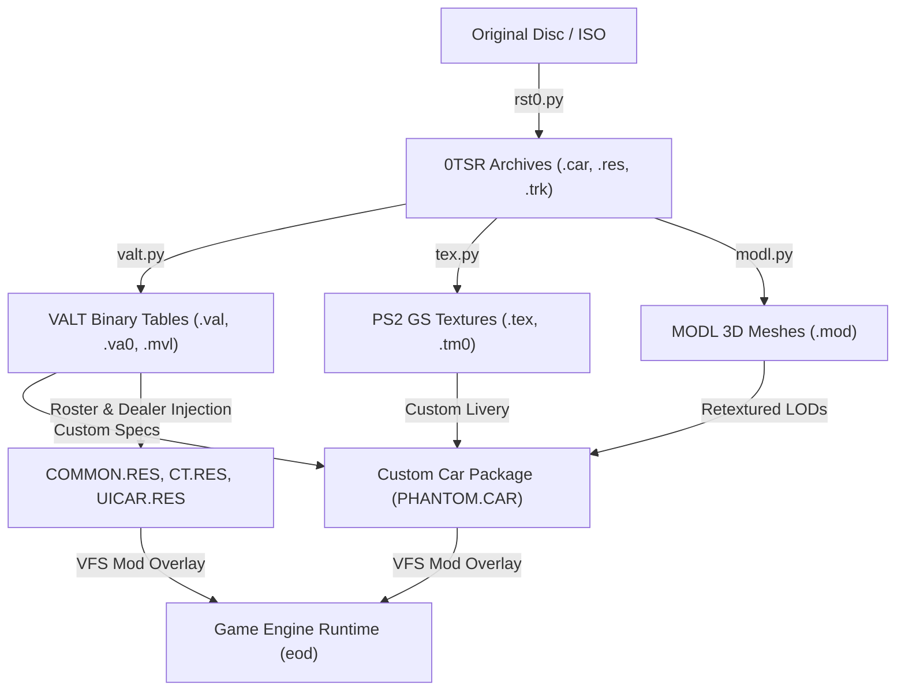

# Custom Vehicle Decompilation, Recompilation & Injection Pipeline

This document describes the complete reverse-engineered pipeline used to decompile, modify, recompile, and inject custom vehicles into **Test Drive: Eve of Destruction** (NTSC-U, `SLUS_209.10`), including custom 3D model bindings, high-resolution textures, physics attributes, career dealership availability, and AI driver rosters.

---

## 1. Pipeline Architecture & Tooling

The native vehicle toolchain operates across four asset layers:

### 1.1 Archive Container: `0TSR` (`tools/rst0.py`)
* **Format:** Container format used for `.car`, `.res`, and `.trk` archives.
* **Header Structure (0x28 bytes):**
  * Magic: `0TSR`
  * Version: `6` (PS2 retail)
  * Directory Offset: `0x80`
  * Header CRC: Computed via native polynomial `0x04C11DB7` (table at `0x003F2598` in `SLUS_209.10` / `f_00135FC8`).
* **Alignment Rule:** Entries are aligned to `0x80` byte boundaries (`cur_offset + ((sz + 0x80) & ~0x7F)`).
* **FourCC Byte Order:** Padded with trailing space before little-endian reversal (`b' XET'` $\rightarrow$ `0x54455820` for `TEX`).

### 1.2 Table Compiler: `VALT` (`tools/valt.py`)
* **Format:** Hierarchical key/value string dictionary format (`.val`, `.va0`, `.mvl`, `.pln`).
* **Structure:** Header specifying section counts, section descriptors (with name offset, parent offset, and pair count), pair key/value string offsets, followed by the null-terminated string pool.
* **Bi-directional Support:** Compiles between raw binary and human-editable JSON/INI formats with 100% logical equivalence.

### 1.3 Texture Converter: `TEX` (`tools/tex.py`)
* **Format:** PS2 GS-swizzled palettized textures (`PSMT8` 8-bit index + 256-color RGBA palette).
* **Swizzling Algorithm:** Implements the PS2 Graphics Synthesizer page/block/column address translation tables (`blockTable8[4][8]` and `columnTable8[16][16]`).
* **Conversion:** Bidirectional conversion between standard RGBA PNGs and PS2 `.tex` / `.tm0` files.

### 1.4 Model Retexturer & Geometry Tool: `MODL` (`tools/modl.py`)
* **Format:** 3D model container holding PS2 VU1 / `SPS4` VIF packet geometry, collision bounding boxes, and material definitions.
* **Retexturing:** Scans material header records and safely updates string table references to bind mesh parts to new texture identifiers (e.g. `Algar.tex` $\rightarrow$ `Phantom.tex`) across all LOD levels (`Low0.mod` to `Low4.mod`).
* **OBJ / JSON Export:** Exports geometry part bounding envelopes, transforms, and hierarchy into standard Wavefront `.obj` and `.json` for DCC inspection.

### 1.5 Audio & Music Toolchain (`tools/audio.py`)
* **Sound Effects (`SFX0`):** Decompiles and compiles `.sfx` sound effect banks to/from standard 16-bit mono PCM WAV files. Encodes/decodes SPU2 ADPCM blocks (16 bytes per block, 28 samples, hardware linear predictor filters).
* **Speech Banks (`SPEECH.BNK`):** Unpacks and repacks indexed voice line sound banks with 0x800-byte (2048-byte) sector alignment and JSON cue manifests.
* **Music Streams (`.pss`):** Demuxes MPEG-2 Program Stream audio from Private Stream `0xBD` (`SShd`/`SSbd` headers) with 512-byte channel interleave, converting 48kHz stereo ADPCM directly into standard `.wav` audio.

### 1.6 Track & AI Spline Toolchain (`tools/trk.py`)
* **Container:** Track archives (`.trk`) use the `0TSR` container format holding meshes (`track.grf`), collision solids (`track.sol`), and AI racing splines (`*.ild`).
* **AI Racing Lines (`ILIN` / `*.ild`):** Decompiles native 3D spline waypoint arrays (node coordinates, velocity limits, left/right track boundary widths, banking angles) into editable JSON and 3D Wavefront OBJ ribbon meshes. Compiles edited JSON back into binary `.ild` files for custom AI racing behaviors.
* **Track Solid Collision (`SOBL` / `track.sol`):** Decompiles oriented bounding box collision primitives into JSON and OBJ wireframes for collision inspection and tuning.
* **Track Retexturing:** Retextures track scenery `.mod` models and `.grf` resources for custom track visuals.

---

## 2. In-Game Integration & Registration

To make a custom vehicle fully playable and driven by AI racers, five resource tables in `COMMON.RES` and two UI bundles must be updated:

| Resource Table | Target Section | Effect / Integration Contract |
| :--- | :--- | :--- |
| **`carclass.val`** | `$0000$chassis`, `$0001$chassis`, `$0002$chassis` | Registers chassis name into tournament tiers (Compact, Midsize, Muscle). |
| **`car_stats.val`** | `carstats` | Sets showroom radar attributes (durability, handling, speed). |
| **`buycar.val`** | `car` & `vehicle` | Adds car to Career Mode dealership with price, description, and livery number. |
| **`dirt.val`** | `Driver` | Assigns custom chassis to AI competitors (e.g. Dale Jefferson, Sam Tallman). |
| **`catalog.val`** | `catalog` | Sets display name string ("Phantom #77") and biography. |
| **`CT.RES`** | `77.tex` / `77.tm0` | Custom car number / livery graphic loaded during car selection. |
| **`UICAR.RES`** | `uicar_77.tex` / `uicar_77.tm0` | In-game HUD vehicle selection thumbnail. |

---

## 3. Live Mod Overlay & Virtual Disc Mounting

The port runtime supports non-destructive mod loading via the `EOD_MOD_DIR` environment variable or local `mods/` directory.

When launched with `EOD_MOD_DIR=mods/phantom`:
1. The virtual ISO driver scans `mods/phantom/DATA/`.
2. New files (`mods/phantom/DATA/CAR/PHANTOM.CAR`) are dynamically injected into the ISO TOC and assigned unique LSN sector ranges.
3. Modified archives (`COMMON.RES`, `CT.RES`, `UICAR.RES`) override the original disc versions on demand without touching retail files.
4. The native game engine reads `PHANTOM.CAR` seamlessly during event setup and spawns the vehicle with its custom physics and livery.

---

## 4. Reverse-Engineered Engine Invariants & Gotchas

### 4.1 VALT v11 Accessible Section Count (`unk1`)
* In the binary table loader (`f_0012C5D8`), section traversal calls `table->GetSection(index)` (`f_00134E78`).
* `GetSection` enforces a hard bounds check: `if (index >= MEM_LW(table + 8)) return NULL;`.
* Header offset `+0x08` (`unk1`) represents the accessible / root section count (`c2`). If `c2 < c1` (total sections), sections appended past `c2` become completely invisible to the game engine, causing fatal panics such as:
  `FATAL: game panic: CarStatsLookup: no such car as Phantom, AFAIK`.
* Compilers must set `c2 = c1` for flat or appended tables to ensure newly injected sections are reachable.

### 4.2 Racing Number Uniqueness Invariant
* The engine performs a global cross-validation of vehicle numbers across both `dirt.val` (`Driver` entries) and `buycar.val` (`vehicle` entries).
* If any driver or dealership vehicle shares an identical integer number (e.g. both using 77), the engine triggers an immediate startup panic:
  `driver: Drivers Josh Black and Phantom Racer have the same number (77)` or `driver: two vehicles (Phantom and Phantom) have the same number (777)`.
* Every driver and dealership vehicle entry must possess a strictly unique integer racing number.

### 4.3 Multi-Class Chassis Registration
* When entering vehicle selection menus across different modes (Arcade, Career, Demolition), the carousel filters vehicles by category sub-tables in `carclass.val` (`$0000$chassis` for Compact, `$0001$chassis` for Midsize, `$0002$chassis` for Muscle).
* Adding the custom car to each relevant class sub-table ensures seamless availability across all race configurations.
